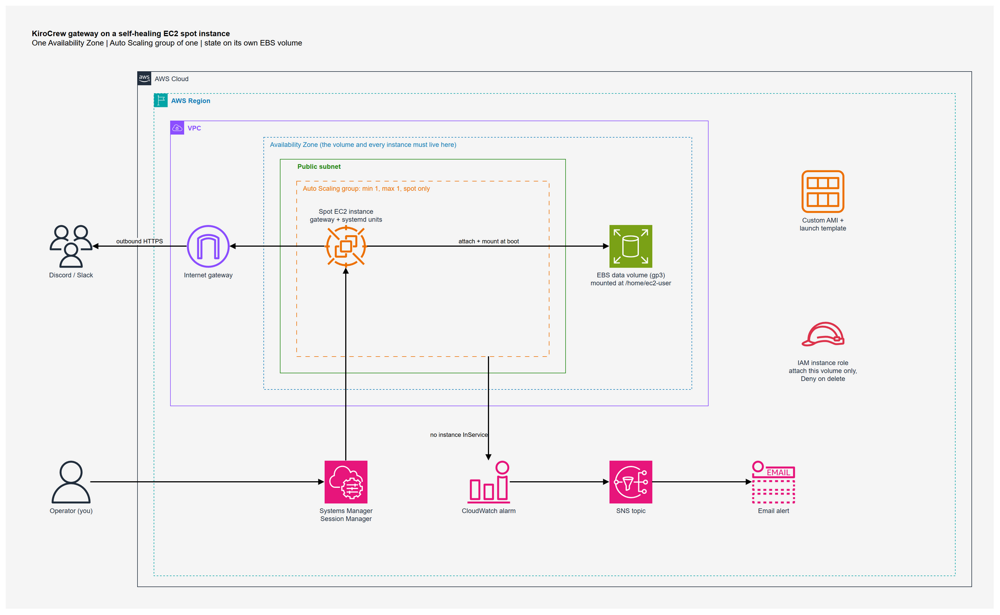

# Run the KiroCrew gateway on a self-healing EC2 spot instance

This tutorial shows you how to run the KiroCrew Discord/Slack gateway on an
Amazon EC2 spot instance that recovers by itself. Spot costs about a third of
the on-demand price, but AWS can take the instance back at any time. When that
happens, this setup brings the gateway back with the same data and no manual
steps.

It is for people who already run the gateway on EC2, or want to, and are
comfortable with the AWS CLI and Linux.

| | |
|---|---|
| **Cost** | About $53 to $79 a month in us-east-1, depending on instance size |
| **Recovery after an interruption** | Usually 3 to 8 minutes, with nobody touching it |
| **Planned downtime to set up** | One cutover. Budget 10 minutes |
| **AWS services** | EC2 (spot), EC2 Auto Scaling, EBS, IAM, Systems Manager, CloudWatch, SNS |

## Use with a coding agent

Copy this into your coding agent (Kiro, Claude Code, Cursor or similar):

```text
Help me deploy https://github.com/4regab/kirocrew-ec2 on my AWS account.

1. Clone the repo. Read README.md, then docs/02-setup-guide.md in full.
2. Copy config.env.example to config.env and ask me for each value you can't
   look up yourself. Never commit config.env.
3. Do the setup guide's steps in order, one step at a time. Run that step's
   checks and show me the results before you start the next step.
4. Ask me before anything that deletes, formats, terminates or causes downtime:
   mkfs, delete-*, terminate-*, detach-volume, and all of step 8 (the cutover).
5. Don't change the design: one AZ, ASG max size 1, and the data volume stays
   out of the launch template.
6. If something fails, check docs/04-troubleshooting.md before you try a fix.
```

## Objectives

- Move the gateway's state onto its own EBS data volume.
- Build a custom AMI that attaches and mounts that volume on every boot.
- Run the gateway in an Auto Scaling group of one spot instance.
- Prove that a replacement instance comes back with the same data.
- Get an email when no instance is running.

## Architecture



Source file: [`docs/architecture.drawio`](docs/architecture.drawio). Open it in
[draw.io](https://app.diagrams.net) to edit it.

1. The gateway runs on one spot instance inside an Auto Scaling group (ASG) with
   min 1 and max 1. It only connects out to Discord or Slack. Nothing connects
   in.
2. All state lives on one EBS data volume, mounted at the app user's home
   directory. The instance's boot disk is thrown away with the instance.
3. When AWS takes the instance back, the ASG launches a new one. On boot it
   attaches the same volume, mounts it, and systemd starts the gateway and a
   `tmux` session for the logs.
4. Before the old instance goes away, a watcher script stops the gateway,
   flushes writes, unmounts the volume and detaches it. It acts on the 2-minute
   interruption notice and on a rebalance recommendation.
5. If the new instance can't attach the volume, it marks itself Unhealthy and
   the ASG replaces it.
6. A CloudWatch alarm emails you through SNS when no instance is in service.
7. You reach the instance through Systems Manager Session Manager, because every
   replacement gets a new public IP.

For why it is built this way, read
[`docs/01-architecture.md`](docs/01-architecture.md).

## Costs

This tutorial uses billable AWS resources. Example for us-east-1 with the
template defaults (8 vCPU / 32 GiB):

| Item | Monthly |
|---|---|
| Spot instance (t3a.2xlarge at about $0.09/hr) | ~$66 |
| Public IPv4 address | $3.65 |
| Data volume, 100 GiB gp3 | $8.00 |
| Boot volume, 20 GiB gp3 | $1.60 |
| ASG, launch template, IAM, CloudWatch alarm, SNS | $0 |
| **Total** | **~$79** |

A 4 vCPU / 16 GiB size costs about $53 a month. The same 32 GiB instance on
demand costs about $220 a month. Prices change. See
[`docs/05-cost-and-tradeoffs.md`](docs/05-cost-and-tradeoffs.md) for how to
check current prices and pick a size.

To stop paying, follow [Clean up](#clean-up).

## Before you begin

You need:

- An AWS account, and the AWS CLI v2 logged in with access to EC2, Auto
  Scaling, IAM, SSM and CloudWatch.
- One subnet in the Availability Zone (AZ) where the data volume will live. It
  needs a route to an internet gateway, because the gateway connects out.
- Amazon Linux 2023 (x86_64) as the base AMI. The scripts assume its package
  names, systemd paths and disk device names.
- An app that keeps all its state under one directory.

Read these before you start:

1. **Your data can't stay on the boot disk.** A launch template always creates a
   fresh boot disk from the AMI. If your state lives on the boot disk today,
   the setup moves it to its own volume.
2. **Mount the volume at the app user's home directory.** Virtualenvs, scripts
   and tools store full paths into the home directory. Mounting at the same
   path keeps all of them working.
3. **Create the data volume fresh. Don't make it from a snapshot.** A volume
   made from an AMI snapshot shares a filesystem UUID with every boot disk built
   from that AMI. XFS then refuses to mount it, and Linux can boot from the
   wrong disk.
4. **Attach and mount the volume from a systemd unit, not user-data.** User-data
   runs only on first boot, so after a reboot the gateway would not start.

Set up your configuration:

```bash
cp config.env.example config.env
$EDITOR config.env                 # set region, AZ, subnet, security group, account id
source config.env                  # every $VAR in the guides comes from this file
```

## Deploy the gateway

Follow [`docs/02-setup-guide.md`](docs/02-setup-guide.md) in order. Steps 1
to 7 don't touch the running service. Step 8 is the only outage. Every step
that deletes or overwrites something comes after a step that checks it is safe.

1. [Inventory what you are migrating](docs/02-setup-guide.md#step-1--inventory-what-you-are-migrating)
2. [Create the IAM role, instance profile and security group](docs/02-setup-guide.md#step-2--iam-role-instance-profile-and-security-group)
3. [Create and format the data volume](docs/02-setup-guide.md#step-3--create-and-format-the-data-volume)
4. [Narrow the IAM policy to this volume](docs/02-setup-guide.md#step-4--narrow-the-iam-policy-to-this-volume)
5. [Bulk copy the data](docs/02-setup-guide.md#step-5--bulk-copy-the-data-application-still-running)
6. [Build the AMI on a throwaway instance](docs/02-setup-guide.md#step-6--build-the-ami-on-a-throwaway-instance)
7. [Create the launch template and ASG, and rehearse](docs/02-setup-guide.md#step-7--launch-template-asg-and-a-dress-rehearsal)
8. [Cut over](docs/02-setup-guide.md#step-8--cutover-the-only-outage)
9. [Prove replacement works](docs/02-setup-guide.md#step-9--prove-replacement-works)
10. [Add the alarm](docs/02-setup-guide.md#step-10--alarm-and-cleanup)

## Verify the deployment

You are done when all of these are true:

- The ASG shows one instance with `LifecycleState=InService` and
  `HealthStatus=Healthy`.
- On the instance, `systemctl is-active kirocrew-storage kirocrew kirocrew-tmux kirocrew-spot-watch`
  prints `active` four times.
- The gateway answers in Discord or Slack.
- After you terminate the instance on purpose (setup step 9), a new one comes
  back with the same data, and two instances never run at once.

The exact commands are in
[setup step 8c](docs/02-setup-guide.md#8c--verify-the-replacement) and
[step 9](docs/02-setup-guide.md#step-9--prove-replacement-works).

## Clean up

To stop all charges, delete the resources in this order. Run the commands from
the repo folder after `source config.env`.

> **Warning:** Deleting the data volume deletes the gateway's state for good.
> Take a snapshot first if you might want it back.

1. Delete the ASG and its instance, then wait for the volume to detach:

   ```bash
   INSTANCE_ID=$(aws autoscaling describe-auto-scaling-groups --region $AWS_REGION \
     --auto-scaling-group-names $ASG_NAME \
     --query 'AutoScalingGroups[0].Instances[0].InstanceId' --output text)

   aws autoscaling delete-auto-scaling-group --region $AWS_REGION \
     --auto-scaling-group-name $ASG_NAME --force-delete
   aws ec2 wait instance-terminated --region $AWS_REGION --instance-ids $INSTANCE_ID
   aws ec2 wait volume-available --region $AWS_REGION --volume-ids $DATA_VOLUME_ID
   ```

2. Delete the launch template, the alarm and the SNS topic:

   ```bash
   aws ec2 delete-launch-template --region $AWS_REGION \
     --launch-template-name $LAUNCH_TEMPLATE_NAME
   aws cloudwatch delete-alarms --region $AWS_REGION --alarm-names kirocrew-gateway-down
   aws sns delete-topic --region $AWS_REGION --topic-arn <topic-arn>
   ```

3. Deregister the AMI and delete its snapshot. Repeat for older AMI versions:

   ```bash
   SNAP_ID=$(aws ec2 describe-images --region $AWS_REGION --image-ids $BUILT_AMI \
     --query 'Images[0].BlockDeviceMappings[0].Ebs.SnapshotId' --output text)
   aws ec2 deregister-image --region $AWS_REGION --image-id $BUILT_AMI
   aws ec2 delete-snapshot --region $AWS_REGION --snapshot-id $SNAP_ID
   ```

4. Delete the data volume, and any snapshots you took during setup:

   ```bash
   aws ec2 delete-volume --region $AWS_REGION --volume-id $DATA_VOLUME_ID
   aws ec2 delete-snapshot --region $AWS_REGION --snapshot-id <pre-migration-snapshot>
   ```

5. Delete the IAM role and instance profile:

   ```bash
   aws iam remove-role-from-instance-profile \
     --instance-profile-name $INSTANCE_PROFILE_NAME --role-name $IAM_ROLE_NAME
   aws iam delete-instance-profile --instance-profile-name $INSTANCE_PROFILE_NAME
   aws iam delete-role-policy --role-name $IAM_ROLE_NAME --policy-name kirocrew-ebs-attach
   aws iam detach-role-policy --role-name $IAM_ROLE_NAME \
     --policy-arn arn:aws:iam::aws:policy/AmazonSSMManagedInstanceCore
   aws iam delete-role --role-name $IAM_ROLE_NAME
   ```

6. Delete the security group:

   ```bash
   aws ec2 delete-security-group --region $AWS_REGION --group-id $SECURITY_GROUP_ID
   ```

## Limitations

- **No zero downtime.** An EBS volume attaches to one instance at a time, so
  there is always a gap while it moves.
- **No protection from a capacity shortage in your AZ.** The volume lives in one
  AZ, so every instance must launch there. If none of your instance types are
  free there, the gateway stays down until capacity returns. List several
  instance types in the ASG to make this rare.
- **Not right for every workload.** AWS says spot is a poor fit for stateful
  services that can't tolerate interruptions. This setup reduces that risk but
  doesn't remove it.
- **The rebalance drain can leave the gateway stopped on a running instance.**
  Read the rebalance warning in
  [`docs/01-architecture.md`](docs/01-architecture.md) before you rely on it.

## What's next

| Document | Read it when |
|---|---|
| [`docs/01-architecture.md`](docs/01-architecture.md) | You want to know why it is built this way |
| [`docs/03-operations.md`](docs/03-operations.md) | It is running and you need to read logs, deploy code, resize, or rebuild the AMI |
| [`docs/04-troubleshooting.md`](docs/04-troubleshooting.md) | Something is broken |
| [`docs/05-cost-and-tradeoffs.md`](docs/05-cost-and-tradeoffs.md) | You are deciding whether spot is worth it, picking a size, or trying to cut the bill |

## Repository layout

```
config.env.example            every deployment setting; copy it to config.env
docs/
  architecture.drawio         architecture diagram source (open in draw.io)
  architecture.drawio.png     the same diagram as an image
  01-architecture.md ... 05-cost-and-tradeoffs.md
scripts/
  build-ami.sh                runs on a temporary instance and builds the AMI
  migrate-home.sh             copies an existing home directory onto the volume in two passes
  instance/
    kirocrew-storage.sh       attaches and mounts the data volume on every boot
    kirocrew-spot-watch.sh    stops the gateway and detaches the volume before shutdown
    kirocrew-selfheal.sh      marks the instance Unhealthy so the ASG replaces it
  systemd/
    kirocrew-storage.service  runs the storage script, calls self-heal if it fails
    kirocrew.service          the gateway itself, restarted whenever it exits
    kirocrew-tmux.service     the tmux session for watching logs
    kirocrew-spot-watch.service
    kirocrew-selfheal.service only runs when the storage unit fails
templates/
  iam-trust-policy.json
  iam-instance-policy.json    minimum permissions, plus a Deny on destructive actions
  launch-template.json
  asg.json
```
